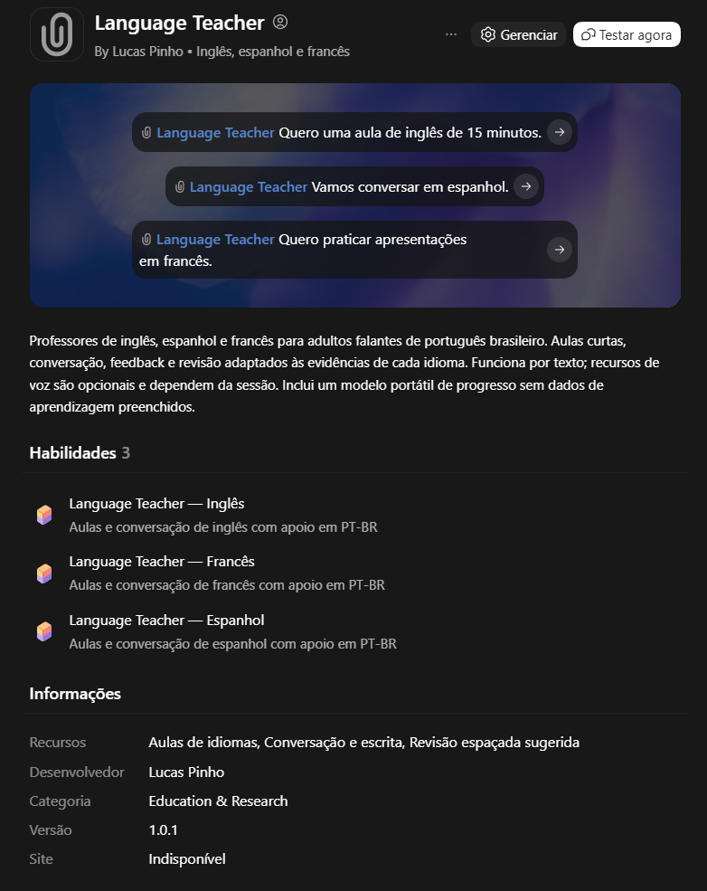

<p align="center">
  
</p>

<h1 align="center">Language Teacher</h1>

<p align="center"><strong>Inglês, espanhol e francês — uma conversa por vez.</strong><br>
Professores adaptativos para adultos falantes de português brasileiro, dentro do ChatGPT.</p>

<p align="center">
  <a href="https://github.com/lucaslapinho/language-teacher/releases/latest/download/Language-Teacher-Plugin.zip">Baixar plugin</a> ·
  <a href="docs/installation.md">Instalação</a> ·
  <a href="docs/examples.md">Exemplos</a> ·
  <a href="project/references.md">Fontes</a>
</p>

Language Teacher reúne três skills de ensino com aulas curtas, conversação, feedback e revisão. Cada idioma mantém seu próprio histórico e começa com uma sondagem informal: o professor não presume seu nível nem transfere sua proficiência de uma língua para outra.

<p align="center">
  
</p>

*Captura da versão 1.0.1 importada no ChatGPT. A versão 1.0.2 organiza a distribuição pública, os metadados e a documentação; mantém a metodologia dos professores.*

## Comece em poucos passos

1. Baixe [Language-Teacher-Plugin.zip](https://github.com/lucaslapinho/language-teacher/releases/latest/download/Language-Teacher-Plugin.zip).
2. Na interface do ChatGPT que oferece importação de plugins, importe o ZIP **sem extrair**.
3. Selecione **Language Teacher** e envie: **“Quero uma aula de inglês de 15 minutos.”**

Se sua interface não oferecer importação, use os [arquivos para projeto](https://github.com/lucaslapinho/language-teacher/releases/latest/download/Language-Teacher-Project.zip). O [guia de instalação](docs/installation.md) explica as duas formas e o uso local no Codex. Acesso aos recursos varia conforme interface e conta.

## Como funciona

Uma aula trabalha uma ação comunicativa concreta: apresentar-se, pedir esclarecimento, escrever uma mensagem ou defender uma proposta. O professor explica brevemente, mostra um modelo e apresenta **uma atividade por vez**, aguardando a resposta.

**Objetivo → recuperação → pequeno conteúdo novo → prática → aplicação independente → feedback → revisão.**

O feedback segue o que funcionou, o ajuste relevante, uma explicação curta e uma nova tentativa. Respostas naturais diferentes do exemplo são aceitas; variantes regionais e sotaques não são tratados automaticamente como erros.

| Professor | Foco inicial | Exemplos de situações |
|---|---|---|
| Inglês | Referência americana, fala conectada e linguagem cotidiana/profissional | Entrevistas, reuniões, viagens, tecnologia e cibersegurança |
| Espanhol | Produção própria além dos cognatos, tonicidade e variantes regionais | Pedir informações, combinar horários e defender uma proposta |
| Francês | Apresentações, cotidiano e relação entre escrita e fala | Nome e cidade, cortesia, vogais nasais, liaison e enchaînement |

As missões cobrem faixas de trabalho **A1–C2**, ajustadas às evidências de cada habilidade. Uma estimativa de aula é informal e não substitui certificação CEFR/QECR.

## Exemplos para experimentar

| O que você quer | Mensagem sugerida |
|---|---|
| Primeira aula | “Quero uma aula de inglês de cerca de 15 minutos. Faça uma sondagem breve antes de escolher o conteúdo.” |
| Entrevista em inglês | “Simule uma entrevista para uma vaga em cibersegurança. Faça uma pergunta por vez e corrija depois da minha resposta.” |
| Destravar o espanhol | “Entendo algumas frases, mas tenho dificuldade para produzir. Vamos praticar pedidos de ajuda com apoio inicial.” |
| Começar francês | “Quero aprender a me apresentar em francês. Explique em português e espere minha resposta a cada atividade.” |
| Trabalhar escrita | “Revise este e-mail, explique o principal ajuste e peça que eu reescreva um trecho.” |
| Retomar | “Use meu registro de progresso anexado e selecione uma revisão curta de espanhol.” |

Veja [três demonstrações de aula e mais exemplos](docs/examples.md). As demonstrações são fictícias e não entram no seu histórico.

### Atalhos textuais

```text
/aula ingles 15
/conversa espanhol
/pronuncia frances
/revisao
/progresso
/mais facil
/mais dificil
```

São convenções interpretadas pelo professor, **não comandos nativos do ChatGPT**. Você também pode escrever normalmente, com acentos.

## Aulas de 5, 15 ou 30 minutos

As durações são aproximadas. Uma aula de cinco minutos pode trabalhar uma expressão e uma aplicação nova; aulas maiores permitem simulações e tarefas de transferência. Diante de dificuldade, o professor reduz a carga e oferece apoio. Com autonomia, aumenta uma exigência por vez.

Missões, pontos e conquistas são opcionais e começam desativados. Não há perda de vidas, punição por ausência ou equivalência entre pontos e CEFR.

## Texto, voz e progresso

O sistema funciona por texto. Voz, imagens, arquivos, Canvas/editor e pesquisa podem enriquecer a aula quando realmente disponíveis. **Transcrição não equivale a acesso ao áudio:** sem áudio original, o professor não avalia pronúncia, entonação ou fluência oral.

O registro portátil separa inglês, espanhol e francês. Salve sua versão atualizada de `learning-progress.json` fora deste repositório e leve-a à próxima conversa. O professor só deve afirmar que salvou após escrita e confirmação reais; caso contrário, entrega uma atualização para você guardar. Não há promessa de memória automática perfeita.

Detalhes: [funcionamento e acompanhamento](docs/how-it-works.md) · [formato do registro](project/progress-format.md).

## Evidências e validação

A metodologia distingue estudos experimentais, referências institucionais e escolhas de implementação. Recuperação ativa e prática espaçada informam a revisão; a sequência inicial de intervalos é uma heurística ajustável. As [fontes consultadas](project/references.md) incluem Conselho da Europa, literatura científica, RAE/ASALE, OQLF e documentação oficial da OpenAI.

Foram documentados **13 cenários simulados e cinco retestes/conferências**. O pacote importável também tem verificações locais de estrutura, caminhos, recursos e imagens. Esses testes não comprovam eficácia de aprendizagem nem compatibilidade com toda interface. Veja [validação e limites](docs/validation.md).

## Estrutura e manutenção

```text
plugin.json                  Manifesto portátil do plugin
.codex-plugin/plugin.json    Compatibilidade
skills/                     Três professores com recursos próprios
project/                    Arquivos para uso em projeto ChatGPT
assets/                     Ícone e descrição do conceito
docs/                       Instalação, exemplos e captura do plugin
scripts/                    Construção e validação locais
tests/                      Cenários simulados documentados
```

Para reconstruir os pacotes, use Python 3.10 ou superior, sem bibliotecas externas:

```bash
python scripts/build.py
python scripts/validate.py
```

Os ZIPs e seus hashes são gerados em `dist/`. Os scripts não instalam plugins, não criam lembretes e não alteram contas. Os arquivos de `project/` são a base dos recursos compartilhados; a construção sincroniza as cópias nas skills. Não coloque progresso pessoal nos modelos distribuídos.

Criado por [Lucas Pinho](https://github.com/lucaslapinho). Ícone gerado com Imagegen; [conceito e prompt](assets/icon-design.md).
